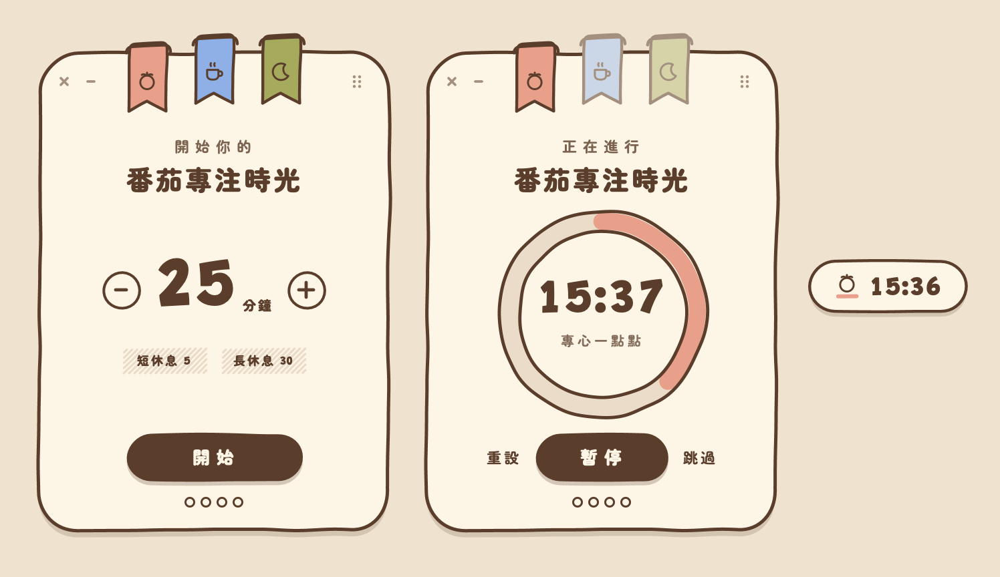

# Doodoro

A hand-drawn pomodoro timer for macOS and Windows that stays on top of your other windows. It is
written in Rust with [GPUI](https://crates.io/crates/gpui), the UI framework behind the Zed editor,
and draws every outline as a GPU path.

一個手繪風、浮在桌面一角的番茄鐘。



## Features

- **Three sessions.** Focus (專注), short break (短休息) and long break (長休息) each have a ribbon
  at the top of the card. Pick one and set its length with − and +. Doodoro remembers each length.
- **A progress ring.** The ring fills as the session runs. You can pause, reset or skip it.
- **A pill mode.** The `–` button shrinks the card to a pill that shows the session's icon and the
  time. Click the pill to open the card again, or drag it to move it. If the pill sits near a screen
  edge, the card opens moved back onto the same screen, and minimising returns the pill to its spot.
- **Always on top.** The window floats above other apps, appears on every Space and over full-screen
  apps, and has no Dock icon. Drag it by the card or the ⠿ grip. It reopens where you left it.
- **An end-of-session alert.** A chime plays and a notification appears when a session ends. The
  card shows 完成了 until you press 下一步.

`space` starts or pauses a session. While one is under way, `r` resets it and `s` skips it.

## Building it

### macOS

You need macOS 12 or later, [Rust](https://rustup.rs) and the Xcode command line tools
(`xcode-select --install`). The first build compiles GPUI and takes a few minutes.

```bash
cargo run --release   # builds and opens the window
./bundle.sh           # builds dist/Doodoro.app
```

`bundle.sh` signs the `.app` ad hoc, so it runs on the Mac that built it. Copy it to
`/Applications` to use it as a regular app. To quit, press the card's × button.

Doodoro saves session lengths to `~/Library/Application Support/Doodoro/settings.json`
and the window's position to the macOS defaults domain `local.doodoro.window`. Set
`DOODORO_SETTINGS` to a file path to keep the settings somewhere else.

`DOODORO_SCREENSHOT=/tmp/app.png cargo run` writes the window, as drawn, to a PNG one second after
it opens.

### Windows

You need Windows 10 or 11, [Rust](https://rustup.rs) 1.89 or later, and Visual Studio 2022 (or its
Build Tools) with the "Desktop development with C++" workload and a Windows SDK. The release build
compiles GPUI's shaders with the SDK's `fxc.exe`.

```bash
cargo run --release      # builds and opens the window
sh bundle-windows.sh     # builds dist/Doodoro-windows.zip, from Git Bash
```

The binary is `target\release\doodoro.exe`, and it runs on its own: the fonts and the C runtime are
compiled into it, so another PC needs nothing installed. `bundle-windows.sh` zips it with the
licences and a short guide in Chinese. The binary is unsigned, so SmartScreen warns the first time
it is opened. To quit, press the card's × button.

On Windows the window floats above other windows and has no taskbar button. It does not float over
games in exclusive full-screen mode. The chime plays through `PlaySound`, and the notification is a
toast that Windows PowerShell shows. Session lengths are saved to `%APPDATA%\Doodoro\settings.json`
and the window's position to `%APPDATA%\Doodoro\window.json`. `DOODORO_SETTINGS` and
`DOODORO_SCREENSHOT` work as on macOS.

## How it is built

The design was made for a browser. GPUI is not a browser, so Doodoro rebuilds these parts another
way.

| Design | Doodoro |
|---|---|
| SVG wobble filter (`feTurbulence` + `feDisplacementMap`) | `src/wobble.rs` samples each outline into points, moves every point by 2D noise once, and keeps the result |
| SVG shapes and icons | `src/draw.rs` tessellates the outlines with [lyon](https://crates.io/crates/lyon) and paints them as GPUI paths. Nothing is rasterised |
| CSS transitions | GPUI's `with_animation`, with the design's cubic-bézier easings |
| `box-shadow` | a second copy of the shape, offset and drawn behind it |
| Web fonts | the three font weights the card uses are compiled into the binary |
| Web Audio chime | `src/desktop.rs` renders the same three triangle-wave notes to a WAV file and plays it with `afplay` on macOS and `PlaySound` on Windows |

The card is 264 × 360. Once a session starts, the other ribbons stay locked until you reset or skip
it, or it ends.

GPUI has no options for some of the window's behaviour, so `build.rs` compiles an AppKit shim,
`window-shim.m`, into the binary. The shim does these things.

- It hides the traffic lights and the window's shadow. The card draws its own × button and shadow.
- It moves the window when you drag the card, and saves where you drop it.
- It resizes the window between the card and the pill, and keeps the card on the pill's screen.
- It floats the window above other apps, on every Space and over full-screen apps.

macOS only lets an accessory app, one with no Dock icon or menu bar, float over another app's
full-screen Space, so the shim makes Doodoro one.

On Windows, `src/native_windows.rs` does the same jobs with Win32 calls and takes the place of
`src/native.rs`. It makes the window a topmost tool window, so it has no taskbar button, and turns
off Windows 11's rounded corners and outline. GPUI keeps an invisible frame around the content, so
the window is placed and saved by its content's rectangle.

## License

The code is under the [MIT License](LICENSE).

The fonts in `fonts/` are [Zen Maru Gothic](https://fonts.google.com/specimen/Zen+Maru+Gothic) and
[Grandstander](https://fonts.google.com/specimen/Grandstander), under the SIL Open Font License 1.1.
The license texts are in `fonts/OFL-*.txt`, and `bundle.sh` copies them into the `.app`.
